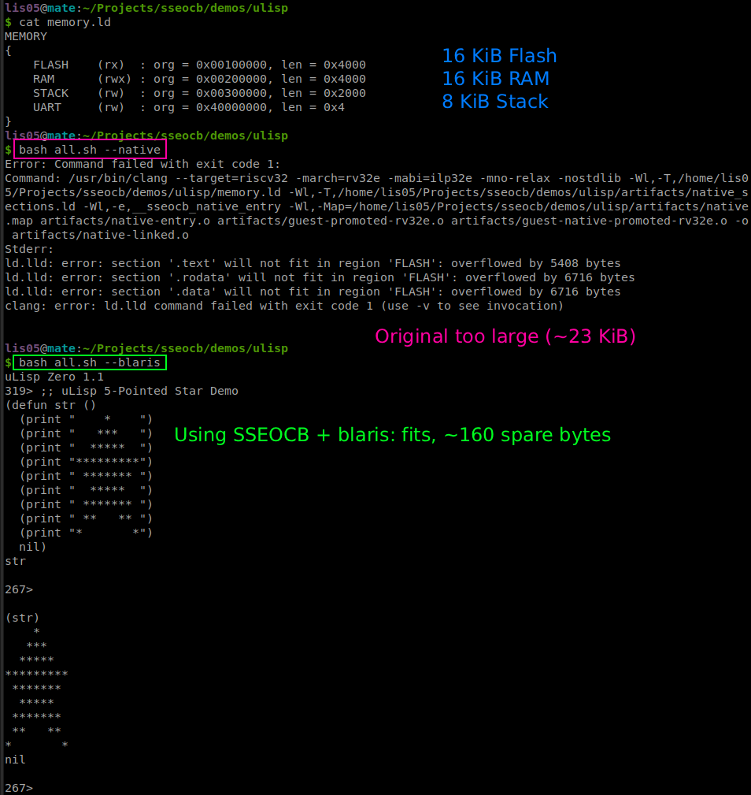
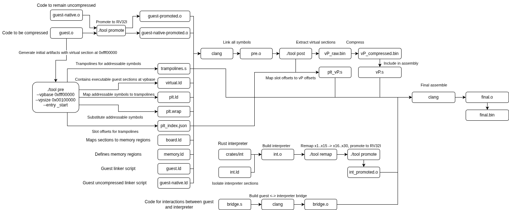

# SSEOCB
Software Side Executor Of Compressed Binaries is a project with a purpose to allow
execution of programs which are larger than the target device's Flash memory size.

## Demo
In this demo, uLisp Zero interpreter is run natively and by using SSEOCB. Native
(uncompressed) program fails to link as it is too large (~23 KiB). With SSEOCB, it
just barely fits in the 16 KiB Flash, outputting a star (see [`demos/ulisp`](demos/ulisp)).

## Background
Small microcontrollers have just a few kilobytes of memory, which limits how large the
programs flashed onto them can be. To run a bigger program, the chip has to be
upgraded (replaced) by a more expensive one. While this is fine for normal users, it
is much more devastating for companies which operate in millions of such devices.

## Target devices
SSEOCB is designed for RV32I architecture. There are several reasons why it was
chosen:
- RV32 is very simple, with most instructions operating only on registers. Memory is
  accessed only by loads and stores, which reduces the complexity of the system.

- RV32I has 32 registers, and also has a reduced architecture RV32E which is similar
  to RV32I with the only difference being that it has 16 registers. This provides a
  great way to isolate guest code from interpreter code, as both can be compiled for
  RV32E and then one simply "remaps" registers to the upper half of the register file (x16–x31).

- RV32I contains only about 40 instructions, and the handler for all of them is
  relatively small. Other architectures, which have many more instructions, would
  require a much bigger handler.

## Core idea
SSEOCB is made of an interpreter runtime and a tool which prepares object files for
the interpreter.

The interpreter is a small bare-metal program which executes the guest program
instruction by instruction. It contains handlers for all 40 RV32I instructions and
the decompressor code for decoding the next instruction from the compressed payload.
It is written in Rust and assembly.

Guest code and the interpreter are both built for RV32E, which means each uses
registers x0 through x15. Later, however, all register accesses in the interpreter
code are remapped to the higher part of RV32I's register file: x0 stays x0, x1
becomes x16, x2 becomes x17, ..., x15 becomes x30. This way, guest and interpreter
code are fully isolated and never interfere with each other.

The guest code is linked in a special way which detects all memory accesses to
guest's .text section. The address is modified in a special way which is recognizable
by the interpreter. This way, all loads/stores/jumps can handle interpreter or
external code correctly.

SSEOCB's tool scans the object file for all addressable symbols (for example
callbacks later used like `register_callback(&callback)`). These symbols are then
wrapped in uncompressed trampolines which have static addresses and can be safely
passed to external code.

The entire pipeline is illustrated in the architecture diagram below. Note that it is
still somewhat simplified.

## Pipeline Architecture

## Structure
SSEOCB consists of several crates in `crates/`:
- `sim/` is a small rv32i simulator.
- `int/` is the interpreter rust and assembly code.
- `tool/` is the host-side tool used to prepare object files.
- `rv32-isa/` contains parsing and encoding functions for RV32I instructions.

In the root:
- `orchestrator/` contains a python tool for building and running programs with
  SSEOCB.
- `e2e/` contains SSEOCB tests which include some simple programs and more complex
  ones (such as Lisp/Basic interpreters)
- `demos/` contains demos that showcase SSEOCB usage.

## Milestones
Completed:
- The system is implemented and can correctly execute compressed binaries using
  `sim/`
- An example guest program is provided such that `C + I < O` where `C` is the size of the compressed program, `I` is the size of the interpreter, and `O` is the size of the original, uncompressed guest program. (demos/ulisp).

In progress:
- Testing and validating the system on real hardware.

Other milestones are not published for the purpose of research.

## Benchmarks
TODO, on real hardware with concrete examples.

## Known limitations
Static symbols cannot be used as handlers. TBD.
